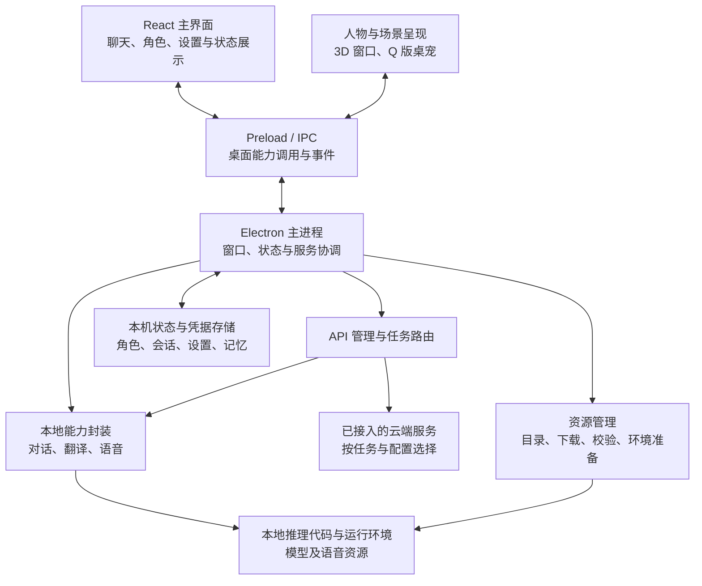
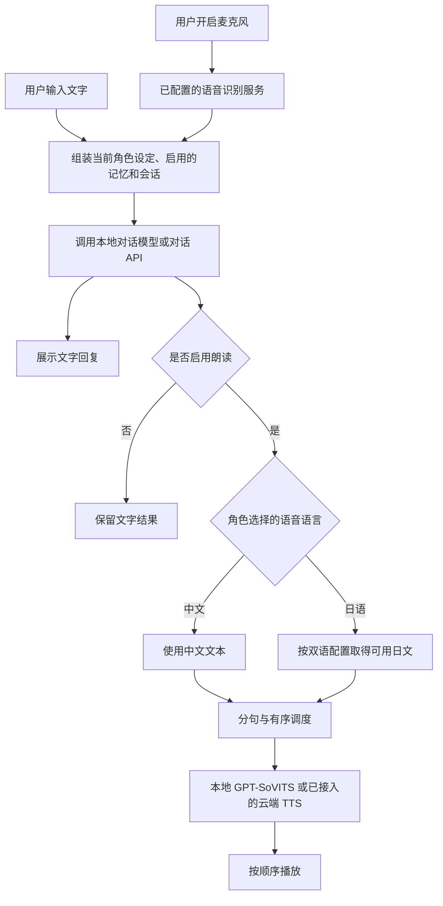

<p align="center">
  
</p>

# Yukino Companion · 雪乃数字人

Yukino Companion 是一款面向 Windows 的桌面对话与陪伴应用。你可以与雪乃或自己创建的角色聊天，显示中日双语回复，使用本地模型或已配置的 API，并选择 3D 人物、Q 版桌宠和语音功能。

**多角色对话 · 本地 / API 模型 · 中日双语 · 语音 · 3D 与桌面陪伴**

**使用指南：** [下载与安装](#download) · [开始使用](#usage) · [功能与边界](#features) · [常见问题](#faq)

**了解项目：** [模型与音色训练](#training) · [设计思路](#design) · [整体架构](#architecture) · [项目结构](#structure) · [3D 与动作编辑器](#motion-studio)

**参与开发：** [当前边界与后续方向](#roadmap) · [AI 协作与分工](#collaboration) · [开发与验证](#development) · [权利声明](#notices)

> 当前提供 Windows 测试版。源码进度与已发布安装器可能不同步；安装器的能力、验收范围和已知问题以对应发行页为准。

<a id="download"></a>

## 下载与安装

1. 打开 [2026-11-02 Windows 测试版发行页](https://github.com/fqxxzyw/Yukino-Companion/releases/tag/v0.4.0-test.20261102.1)，下载 [Yukino-Companion-0.4.0-Base-Setup.exe](https://github.com/fqxxzyw/Yukino-Companion/releases/download/v0.4.0-test.20261102.1/Yukino-Companion-0.4.0-Base-Setup.exe)。请先阅读发行页中的已知问题和验收范围；其他版本可在 [Releases 下载页](https://github.com/fqxxzyw/Yukino-Companion/releases)查看。
2. 运行安装器，按提示选择安装位置。安装文件和数据建议放在有足够空闲空间的磁盘；请勿选择包含其他重要文件的非空目录。安装程序及其附件的大小、校验值以对应发行页为准。
3. 启动 Yukino Companion。首次配置可按需选择本地对话、日语翻译、语音合成和桌宠语音，也可以先跳过，使用 API 文字聊天。
4. 选择本地功能时，确认资源目录、预计下载量和运行环境，再开始准备。资源文件会按清单下载并校验；下载量、所需空间及耗时取决于所选功能、已有文件与网络条件。

本次安装器的 SHA-256 为 `6b791a79a96ef8afc89d1e55d399e2861f12f27fc7876c54211d7ccc0f3ffe0b`。在下载目录打开 PowerShell，可用以下命令计算并与该值比较：

```powershell
Get-FileHash -LiteralPath '.\Yukino-Companion-0.4.0-Base-Setup.exe' -Algorithm SHA256
```

基础安装器包含应用、七个内置角色、默认壁纸和参考音频；**安装过程中不下载资源，也不内置本地模型权重或推理运行环境**。应用提供资源配置与安装入口；Python、PyTorch、llama.cpp 和 GPT-SoVITS 等依赖及所选模型权重由资源向导按需准备。安装程序成功不代表模型、音色或推理环境均已准备好；请以应用内资源检查、真实请求和试听结果为准。

程序面向 **Windows 10 或更新版本的 x64 系统**。本地推理可选择 CPU；若有受支持的 NVIDIA 显卡，可在资源向导选择可用的 CUDA 环境。CUDA 配置会准备基础环境并从官方 PyTorch 与 llama.cpp 来源安装相应依赖，需要网络、足够磁盘空间和 NVIDIA 驱动。自动模式会检查实际环境；显卡型号、驱动、可用显存和依赖都影响能否使用 GPU。没有 NVIDIA CUDA 时不要把检测到显卡等同于 CUDA 已就绪。

> 请从本仓库的发行页下载应用。发行页中用于模型、语音或运行环境下载的资源附件是独立依赖，可能被不同版本引用；不要把它们当作另一个应用安装器。

<a id="usage"></a>

## 开始使用

### 聊天：本地模型或 API

- **本地对话**：在首次配置或「设置 → 高级与资源 → 本地模型与资源」中准备本地对话模型和公共推理环境，在聊天来源中选择本地后发送消息。首次加载通常比后续回复慢；资源检查通过后仍应发送实际消息确认可用。
- **API 对话**：打开「设置 → 模型与 API」，点击「添加 API」，选择服务商、填写凭据并保存，然后在「分配任务」中选择对话配置。可用模型、权限、地域和费用由所选服务商决定。保存配置不等于连接或模型能力已验证。
- 点击停止按钮可中止当前回复；会话与角色资料保存在本机。切换角色后，后续对话使用该角色的设定和记忆。

### 翻译与朗读

1. 在「设置 → 双语与翻译」选择**不翻译、本地翻译或已配置的 API 翻译**。本地翻译用于中文到日语；不翻译时保留原文，不会自动发起收费翻译。
2. 在「设置 → 语音输出」选择本地 GPT-SoVITS、已接入的云端语音或不朗读。使用本地语音需准备公共模型、GPT / SoVITS 权重和参考声音；云端语音需配置对应服务和凭据。
3. 调整音量、自动朗读等选项，并点击试听确认实际合成与播放。选择云端服务时，文本会发送给服务商，可能产生费用；本地与云端语音互不要求对方的资源。
4. 在「角色管理」创建角色时，可选择音色与**中文或日语语音**；已有角色也可在该页面修改语音语言。中文朗读使用中文回复，日语朗读使用日文版本；音色本身需要支持所选语言。

回复会按标点分段，首段尽早合成；标准本地引擎可将后续已准备好的句子组成小批次，并按原顺序播放。实际并发、显存占用和速度取决于所选引擎与硬件，不保证所有引擎都能同时推理多句。翻译、合成或播放失败时，文字回复仍可查看。

### 角色、人物与桌面陪伴

- 在「设置 → 角色管理」选择已有角色或点击「新建角色」。姓名和角色设定必填；音色与 3D 模型可选。设定可手动编辑，也可复制提示词，或主动选择已配置的对话 API 起草并审阅。
- 在「人物与桌面」调整人物显示、桌宠、气泡、置顶和鼠标穿透等选项。关闭主窗口时可选择保留人物、桌宠、两者或完全退出；保留桌面形象时可通过系统托盘重新打开主窗口。
- 桌面 3D 人物可用滚轮或方向键调整大小，拖动人物可旋转。内置服装仍遵循各自的可用状态与解锁条件；自定义 GLB 可在「高级与资源 → 导入人物模型」中检查并导入。

### 语音输入与视觉

在「语音输入」中选择已接入的识别服务并检查麦克风；语音识别和语音输出是两项独立配置。在「视觉」中选择屏幕或摄像头并先预览，只有确认发送后才会将画面交给配置的视觉服务。服务列表中的能力与实际协议接入状态请以界面为准。

<a id="features"></a>

## 功能与资源说明

| 功能 | 实现与使用边界 |
| --- | --- |
| 对话 | 可使用本地角色模型或兼容的对话 API；模型质量和角色一致性因模型、上下文与配置而异。 |
| 双语 | 支持中文、日文及双语显示。本地 Hy-MT2 翻译资源与对话模型是独立组件，翻译结果需要结合上下文判断。 |
| 本地语音 | 使用 GPT-SoVITS；首次推理会加载模型。语速、设备、参考声音及高级推理参数在语音设置中调整，音质需要实际试听。 |
| 云端语音 | 已接入阿里云百炼语音合成；复刻音色使用匹配的模型。创建前需确认录音使用授权并主动上传；真实账户权限、音色审核和收费以服务商为准。 |
| 语音输入 | 支持已接入的阿里云实时识别；其他服务商目录项可能尚未接入，不能仅凭保存密钥认定可用。 |
| 场景与外观 | 可切换内置场景、主题和壁纸。自动定位与天气获取是可选功能，定位授权和请求会在界面中说明；并非所有场景都提供对应天气的视觉效果。 |
| 本地资源 | 模型、默认音色、语音公共模型、桌宠预录语音与共享运行环境分别管理。默认资源位置在安装目录的 `Yukino-Data`；更换资源目录按界面提示重启。 |

本地模型下载完成和文件校验成功，只说明资源已准备，不等于 GPU 推理或音频播放已通过。使用 CUDA 时建议在「语音环境与诊断」检查设备，并通过真实对话、翻译和试听确认。显存不足可能导致错误或按设置回退 CPU；多屏、不同 DPI、长时间运行及特定硬件仍需在自己的设备上验证。

### 隐私与安全

- 对话、角色、记忆和应用设置保存在本机；API 凭据通过系统安全存储保存。云端聊天、翻译、识别、语音合成和视觉请求会向你选择的服务商发送对应内容。
- 声音复刻只在选择录音、确认有权使用并点击上传后发送音频。请自行确认录音授权和服务商费用。
- 可选的合成音频缓存默认关闭；开启后音频以可播放文件保存在本机，并非加密存储。可以在语音输出设置中查看与调整。
- 天气获取需要明确开启并授权位置；应用会将经纬度舍入后发送至 Open-Meteo。关闭后恢复本地时钟光照，实际天气视觉效果取决于场景支持。

<a id="faq"></a>

## 常见问题

**安装后为什么还要下载资源？** 基础应用和本地模型运行环境分开发放。选择本地功能后，向导会检查并按需准备相应组件；只用 API 聊天可以跳过本地模型。

**有 NVIDIA 显卡，为什么仍在使用 CPU？** 硬件检测、CUDA 运行环境和实际模型设备是不同状态。请检查驱动、所选环境与显存，再在设置中检查实际推理设备；CPU 环境不会因为存在显卡自动变成 CUDA 环境。

**为什么没有声音？** 检查语音输出是否选择了不朗读、角色是否单独设置为不使用语音、自动朗读与音量是否开启。本地方式请检查权重和参考声音；云端方式请检查 API Key、地域、模型和音色，并使用试听确认。日语朗读需要可用的日文文本；选择不翻译时不会为朗读偷偷补译。

**更换电脑或安装目录后资源不见了？** 不同安装目录分别管理本地推理资源。可在资源设置中明确选择目录或重新准备；不要直接删除旧目录中的聊天、模型或其他个人文件。

**下载或安装失败怎么办？** 查看设置中的错误详情、网络和目标目录可用空间；确认来源可访问后重试。不要仅凭进度条或文件名判断文件已校验完成。

---

<a id="training"></a>

## 对话模型与音色训练

为了让雪乃既能以自己的方式回答，也能通过声音表达，项目分别准备了**文字对话模型**和 **GPT-SoVITS 音色**。它们是两套独立资源：前者影响生成什么文字，后者负责将文字合成为语音。角色设定提示词、本地翻译模型与桌宠预录语音也各自独立，不会因为训练或更换其中一项而自动改变其他组件。

### 本地对话模型：从人物知识到性格训练

项目以固定版本的 `Qwen2.5-1.5B-Instruct` 为基础，使用 LoRA 进行监督微调，而不是从零预训练一个语言模型。早期工作将用户提供的 20 本 EPUB 清理、分章节并建立本地检索索引；另外从人物介绍整理出 113 条训练样本和 29 条验证样本，训练了 3 个 epoch、87 个优化步骤的人物知识 LoRA。小说全文用于当时开发服务的检索，不能说全部内容都被逐句训练进模型参数。

在此基础上，2026-10-25 又从已有知识 LoRA **继续训练同一个适配器**，重点转向角色在日常交流、求助、分歧、安慰和边界等场景中的判断与表达。训练使用原创合成场景，按照场景族划分集合，尽量避免同一场景的不同问法同时进入训练和测试：

| 项目 | 本次实际记录 |
| --- | --- |
| 数据划分 | 训练 62 个场景族 / 186 条；验证 8 族 / 24 条；保留测试 8 族 / 24 条，每族三种上下文 |
| 训练方式 | assistant-only LoRA SFT，只对目标回答计算损失；使用同源角色训练卡 |
| 训练环境与参数 | 云端 Linux CPU，BF16；1 个 epoch、47 个优化步骤，batch size 1、梯度累计 4、学习率 `5e-5`，序列上限 1024 token |
| 验证与导出 | 验证 loss 从约 `3.63267` 降至 `3.24914`；合并基础模型与适配器后导出 Q4_K_M GGUF，并通过桌面 JSONL worker 在 CPU 上完成真实离线生成检查 |

这些数据由合成场景构成，场景之间仍可能存在语义相似；验证 loss 下降也不能单独证明人物还原。实际测试中仍出现人物关系错误、虚构剧情以及对输入状态和身份的错误或不必要表述。因此，模型适合试用和继续改进，不能视为已完整还原角色或可靠掌握全部作品知识。具体过程、原始测试与局限见[续训验证报告](model-service/reports/persona-continued-validation.md)和[知识微调验证](model-service/reports/validation.md)。

桌面应用使用合并后的 GGUF 进行本地对话，模型和运行环境按需准备；API 对话则使用所选服务商的模型与应用提供的角色设定，不会修改服务商的模型权重。小说原文、私人索引及相关训练数据不进入 Git 仓库。

#### 继续研究或重新训练

训练工程与桌面应用分开，普通使用无需自行训练。准备 Python 环境、训练依赖和基础模型后，可在 `model-service` 目录构建原创性格数据并启动默认的**全新**性格 LoRA 训练：

```powershell
cd model-service
python -m yuki_model download
python scripts/build_persona_sft.py --tokenizer models/base --character-pack ../characters/yukino
python -m yuki_model train --config configs/train-persona.json
```

默认配置新建适配器，不会自动复现上面记录的知识 LoRA 续训。若要从已有适配器继续训练，需要兼容的基础模型、原适配器和训练报告，并按文档显式配置续训、重新评估知识保持情况。数据准备、设备要求、评估与导出步骤详见[性格训练流程](model-service/docs/persona-training.md)和[模型服务说明](model-service/README.md)；仅有代码或训练配置不代表已经完成一次训练。

### 雪乃音色：训练成果与应用接入

项目接入了此前训练并发布的雪乃 **GPT-SoVITS v1** 音色。已登记的资源包括 GPT `e1`–`e5` 与 SoVITS `e1`；默认组合为 GPT `e2` + SoVITS `e1`。不同轮次需要实际试听比较，数字更大不代表音质一定更好。权重和对应资源可在[音色资源发行页](https://github.com/fqxxzyw/Yukino-Companion/releases/tag/v0.1.0-framework.1)查看，具体文件与校验信息记录在[音色资源清单](resources/voice-models.json)。

本地合成需要兼容版本的 GPT `.ckpt`、SoVITS `.pth`、公共 BERT/HuBERT 模型、运行环境，以及与参考语言匹配的参考音频。默认参考录音约 3.083 秒；其日语文本由 Whisper small 和 medium 分别转写并核对一致，但尚无人工听校记录。也可以在应用中选择自己的兼容权重和参考录音，并通过试听检查实际效果。参考录音和转写的详细记录见[默认音色说明](resources/voice-presets/README.md)。

历史验证中，默认组合在 Windows CPU 上生成过非静音语音；这证明该次合成链路能够运行，并不能代替人工听感、音色相似度、其他权重组合或 GPU 实机验收，参见 [0.4.0 验证记录](docs/VALIDATION_0.4.0.md)。仓库目前保留的是权重清单、参考音频与推理接入记录，没有完整的音色训练素材、参数和训练日志；因此这里不推测训练时长、数据量或训练步骤。应用提供音色选择与推理，不提供一键本地音色训练；使用或分享录音与权重前请确认相应授权。

---

<a id="design"></a>

## 项目设计思路

### 从一个角色开始，而不是从功能清单开始

这个项目的起点，是希望让雪乃不只出现在一段聊天文字里：打开应用时可以交流，收起窗口后仍能以桌面形象存在；文字、声音和人物展示可以使用同一份角色设定，而不是三个彼此无关的演示。

围绕这个目标，项目逐步加入了角色管理、本地与 API 对话、双语、语音、3D 展示、桌宠和资源配置。设计重点不是同时开启尽可能多的模型，而是让这些能力能够按需组合：只需要文字聊天时，不强制准备语音模型；更换对话服务时，不必重新建立角色；某个可选环节失败时，尽量保留已经得到的结果。

以下说明区分**设计目标、已有代码和后续方向**。结构梳理基于源码提交 `7ff0f43`；源码中的模块不代表已全部进入上方链接的安装器，也不等同于已经在所有设备上通过实机验收。

### 1. 角色、服务和呈现分开管理

我希望把三个容易混在一起的问题拆开：**角色是谁、能力由谁提供、角色如何出现。**

| 层面 | 负责的问题 | 设计意图 |
| --- | --- | --- |
| 角色 | 姓名、设定、角色记忆，以及可选的音色和模型绑定 | 保留角色身份，不把角色等同于某个 API 模型名称。 |
| 服务 | 对话、主动消息、视觉、识别、翻译、合成的配置与任务分配 | 允许不同任务使用不同服务，而不是一个配置包办所有功能。 |
| 呈现 | 聊天界面、3D 人物、Q 版桌宠、场景和语音播放 | 根据使用场景切换表现形式，而不重新创建一套角色。 |

例如，更换对话 API 不应改变角色姓名和设定；角色没有绑定 3D 模型，也不应因此失去文字聊天能力。音色和模型是角色的可选表现资源，不是创建角色的前提。

当前的入口分别位于 [角色状态管理](src/companion/characters.mjs)、[人格与记忆组装](electron/persona.cjs)、[API 管理](electron/api-management.cjs) 和 [人物与桌面管理](electron/companions.cjs)。这些模块仍通过应用状态和主进程协作，并不是彼此完全独立的服务。

### 2. 统一管理 API，但按任务分配能力

“配置了一个 API”不等于它支持识别、视觉和语音合成。项目将服务商配置与任务路由分开：前者保存服务信息与凭据关联，后者决定某项任务实际使用哪一个配置。

现有任务包括 `chat`、`proactive`、`vision`、`asr`、`translation` 和 `tts`。路由解析时检查配置是否存在、是否声明支持该任务，以及适配器是否已接入；只存在于服务目录中的项目不能仅凭填入密钥就被视为可用。

这一设计允许按任务选择成本、速度和能力不同的模型，同时明确“目录展示”“协议已接入”“真实账户请求已验证”是不同状态。代价是配置关系更多，因此设置界面需要让用户看清**当前任务选中了什么，以及为什么不能使用**。

实现入口：[任务定义与服务目录](electron/api-management.cjs)、[任务路由](electron/task-routing.cjs)、[服务管理](electron/api-service-manager.cjs)。

### 3. 文字回复、翻译、合成与播放不绑成一个步骤

语音交互不是一次模型调用，而是一条由不同组件构成的处理链。项目将语音识别、对话生成、翻译、合成和播放分别配置、分别处理状态。

以“中文交流、日语朗读”为例，识别服务先把语音转换成文字；对话模型产生回复后，按双语配置取得日文，再交给语音引擎。文字展示不应等待整段音频生成结束，语音失败也不应删除已经生成的文字。

流式朗读进一步分为文本分句、任务调度、语音合成与有序播放。这样可以让首段先开始处理，也能在取消当前回复时停止旧任务，避免上一轮的语音继续混入下一轮。

当前代码包含 [流式语音会话](src/speech/streaming-session.mjs)、[句子切分](src/speech/segmenter.mjs)、[有序调度](src/speech/scheduler.mjs) 和 [播放器](src/speech/player.mjs)。实际并发能力仍取决于引擎与设备，不能将“分段处理”直接等同于固定低延迟或无限并行。

日语朗读只是其中一种配置，不是所有角色的强制路径。角色可以选择中文语音；关闭翻译时，也不应为了朗读而隐式调用收费翻译服务。

### 4. 基础应用与大资源分开发放

本地对话、翻译和语音使用的模型、权重和运行环境并不相同。如果把它们全部作为首次使用的前提，只需要 API 文字聊天的用户也会承担不必要的下载与配置成本。

因此，项目采用基础应用与可选资源分离的方式，由资源向导按功能准备依赖。资源目录、下载校验和实际推理检查也分开处理：**文件下载完成、运行环境就绪、模型成功加载、真实请求成功，是四件不同的事。**

这项取舍降低了只使用部分功能时的准备负担，但增加了资源状态管理的复杂度。项目需要说明缺少哪个组件、正在准备哪一步、失败后应该从哪里继续，而不是只显示一个总进度条。

相关入口：[资源目录](electron/resource-directory.cjs)、[资源下载](electron/resource-download.cjs)、[运行环境管理](electron/runtime-manager.cjs) 和 [首次配置](electron/setup.cjs)。具体设备是否可用，仍以真实对话、翻译与试听为准。

### 5. 桌面形象切换要保持连续感

主界面中的人物和桌面上的人物，在体验上应当是同一个角色，而不是关闭一个窗口后突然生成另一个对象。

因此，窗口展开与收起的设计需要同时考虑人物位置、显示比例、窗口边界和当前展示模式。位置接近屏幕边缘、窗口空间不足、多屏或 DPI 不同时，也需要有可解释的调整策略，而不是机械复制一组坐标。

这是人物框与桌宠联动的设计目标。源码中已有窗口切换协调和布局状态传递的处理，但“存在处理逻辑”不等于所有位置、缩放和硬件组合都已经表现正确。相关体验应通过连续操作录像和实机验证判断，而不只看单张界面截图。

阅读入口：[桌面形象管理](electron/companions.cjs)、[主进程中的窗口打开协调](electron/main.cjs) 和 [主界面的布局交接状态](src/main.jsx)。

### 6. 记忆先明确边界，再逐步演进

目前的人格组装会读取当前角色的设定和启用的记忆文本，并根据模型与提示词模式施加长度预算；本机对话路径还会限制历史上下文规模。记忆内容作为资料参与对话，而不是被当成可以改写行为规则的指令。

这与“已经实现自动提取、向量检索和记忆冲突消解的完整长期记忆系统”不同。后续方向是保留近期对话，同时为历史片段建立索引，在相关话题出现时只取回必要内容；对学习进度等会变化的信息，还需要记录时间和有效状态，避免新旧记录同时被当作当前事实。

这些检索与更新机制属于演进方向，不作为当前版本已交付能力宣传。当前实现可从 [人格与上下文组装](electron/persona.cjs) 查看。

<a id="architecture"></a>

## 整体架构

项目以 Electron 桌面应用为主体，React 负责主界面，Three.js 参与人物与场景呈现；本地推理相关能力通过对应服务封装与 Python 侧代码衔接。

下图按职责解释现有结构，不表示每一个方框都是独立进程或微服务。开发阶段使用的 Codex、MCP 或模型制作工具，不属于这张应用运行时架构图。



**界面负责表达状态，主进程协调桌面与服务能力，适配模块处理具体协议和推理调用。** 当前部分协调逻辑仍集中在入口文件中；这里展示的是职责划分，不将项目描述成已经完成严格分层重构的系统。

主要入口：[前端入口](src/main.jsx)、[桌面入口](electron/main.cjs)、[IPC 桥接](electron/preload.cjs)、[依赖与构建脚本](package.json)。

### 一次对话如何运行

下面展示一条典型的“中文输入、日语朗读”路径。普通文字聊天可以跳过识别、翻译和朗读；实际执行以用户配置、角色语言与已接入能力为准。



取得日文可以来自配置允许的双语结果或翻译步骤，并不意味着每次都追加一次翻译请求。缺少可朗读文本、合成失败或用户取消时，应保留文字并说明语音状态，而不是虚报整个链路已经成功。

<a id="structure"></a>

## 项目目录与阅读入口

以下是便于理解职责的主要目录，不是完整文件清单。部分大模型、声音和人物资源按需准备，源码目录不能替代安装器或资源包。

```text
Yukino-Companion/
├─ src/                         # 主应用前端
│  ├─ main.jsx                  # 聊天主界面与应用状态协调
│  ├─ ui/                       # 设置、角色、场景及通用界面
│  ├─ companion/                # 角色状态与人物相关前端逻辑
│  ├─ scenes/                   # 场景相关实现
│  ├─ speech/                   # 语音输入界面、分句、调度与播放
│  ├─ model-window.jsx          # 桌面 3D 人物窗口入口
│  └─ visual-window.jsx         # 视觉窗口入口
├─ electron/                    # 桌面主进程与服务封装
│  ├─ main.cjs                  # 应用生命周期、窗口和服务协调
│  ├─ preload.cjs               # 主界面的桌面 API 桥接
│  ├─ api-management.cjs         # 服务目录与 API 配置结构
│  ├─ task-routing.cjs           # 按任务选择配置并检查能力
│  ├─ persona.cjs               # 人格、记忆与上下文组装
│  ├─ companions.cjs            # 桌面人物和桌宠管理
│  ├─ local-chat.cjs            # 本地对话服务封装
│  ├─ translation.cjs           # 翻译服务封装
│  ├─ speech.cjs                # 本地语音服务封装
│  └─ motion-editor.cjs          # 动作编辑器的桌面接入
├─ model-service/               # 本地对话相关代码，包括桌面 worker
├─ inference/                   # 本地语音推理相关 Python 代码
├─ translation/                 # 本地翻译相关代码、清单及许可
├─ motion-studio/               # 动作时间线编辑器子项目
│  └─ src/motion/               # 编辑器与独立播放器共享的动作逻辑
├─ characters/                  # 角色规范与相关声明
├─ resources/                   # 服务、模型、音色等资源清单与配置
├─ public/                      # 前端静态资源与人物、场景资产入口
├─ scripts/                     # 资源准备、开发、打包与验证脚本
├─ tests/                       # 自动化测试
├─ docs/                        # 开发、资源与发布说明
└─ .github/workflows/           # 自动化检查与构建工作流
```

第一次阅读代码，可以先从 [src/main.jsx](src/main.jsx) 与 [electron/preload.cjs](electron/preload.cjs) 看界面如何请求桌面能力，再看 [electron/main.cjs](electron/main.cjs) 中的处理与服务初始化。之后按兴趣阅读任务路由、语音处理或人物展示模块，不必一开始通读所有文件。

<a id="motion-studio"></a>

## 3D 资产与动作编辑器

数字人的表现不只取决于聊天模型。眨眼、闭眼、嘴型、头发和服装表现，还取决于模型本身是否具备正确的骨骼、表情通道与资源适配。动作模块也不能因为在一套模型上可用，就被认为能无条件迁移到所有服装。

动作编辑器的设计，是把动作制作从主聊天流程中分离出来：在工作台编辑和录制关节或表情，将其作为可复用模块安排到时间线，再保存工程或导出动作包。

当前仓库包含 `motion-studio/` 子项目，主应用也有打开独立编辑窗口的接入代码。编辑器文档介绍了时间线、录制、动作包导出和共享求值逻辑。具体模型的通道可用性、导出结果，以及动作包在目标运行时的接入，需要分别验证，不能仅凭编辑器窗口可打开就宣称全部完成。

工具关系可以概括为：**模型准备与适配 → 动作编辑和预览 → 保存工程 / 导出资源 → 在目标运行时验证。** 使用 Blender、MCP 等制作资产属于开发与内容生产流程，不等同于应用已具备自主控制 Blender 的通用 Agent 能力。

入口：[动作编辑器说明](motion-studio/README.md)、[桌面接入](electron/motion-editor.cjs)、[动作核心模块](motion-studio/src/motion/index.ts)。

<a id="roadmap"></a>

## 实现边界与后续方向

判断一项能力是否可用，需要区分“已有实现入口”“在某个环境测试通过”和“当前发行版已完成目标设备验收”。代码、演示和发布状态不相互替代。

| 方向 | 当前可确认的范围 | 仍需明确或继续验证的部分 |
| --- | --- | --- |
| 角色与记忆 | 角色设定、可选资源绑定、记忆文本注入和上下文预算处理有实现入口。 | 自动记忆提取、历史检索、冲突更新不作为当前完整交付能力。 |
| API 路由 | 有任务定义、配置选择、能力检查与未接入项拦截。 | 各服务的真实账户权限、具体模型能力和端到端请求仍需测试。 |
| 双语与语音 | 有翻译配置、分句、语音会话与调度播放模块。 | 硬件速度、音质、取消和长会话表现需要实测，不承诺固定延迟。 |
| 桌面与 3D | 有人物窗口、桌宠管理、布局交接和资源导入相关入口。 | 不同屏幕、DPI、位置及模型的视觉和交互表现需要持续验收。 |
| 动作编辑器 | 已包含独立子项目、主应用入口及编辑器文档。 | 各模型通道、动作迁移、导出及运行时接入分别核验。 |
| 资源与环境 | 有安装引导、目录管理、资源下载及运行环境准备。 | 资源完整性、GPU 就绪、模型推理与真实播放不能混为同一状态。 |

后续优先改进方向是让核心链路更稳定、错误信息更明确、模型与动作适配更可验证，再逐步扩展记忆检索和服务支持。未实现或未验收的方向，不使用“已完成”“全支持”等表述。

<a id="collaboration"></a>

## AI 辅助开发与个人分工

本项目采用 AI 辅助开发。我的主要工作是确定产品方向、设计交互与功能方案、拆解任务、明确约束，并通过实际使用与反馈推动迭代；Codex 承担了主要的代码生成、功能实现和排错工作。

因此，项目所体现的个人实践主要是：如何把一个长期陪伴的想法拆成具体模块，如何在本地与云端能力之间作出取舍，以及如何让 AI 的实现结果接受功能和体验检查，而不是将所有代码描述为独立手写。

开发阶段使用的 Codex、大肥鱼及相关 MCP 辅助工作流，与应用安装后的运行依赖分开说明。第三方工具的使用、交互参考和实际代码或资源复用，也应分别记录；实际复用遵循对应的许可与声明。

AI 生成的实现不能替代验证。文档应以真实功能、可复现步骤和明确的已知限制为依据，不以生成代码的数量或功能名称的数量代替完成度。

---

<a id="development"></a>

## 开发与验证

项目使用 Electron、React、Vite 和 Three.js。需要 Windows x64、Node.js / npm 以及项目锁文件指定的依赖；本地推理的 Python 依赖由项目运行环境管理。

```powershell
npm ci
npm run dev:web       # 浏览器界面预览，不提供桌面 IPC 或真实推理
npm run dev:desktop   # Electron 开发版，使用独立开发数据目录
npm test              # Node 测试；前置步骤会检查角色及壁纸资源
python -m unittest discover -s tests -p '*_test.py'
npm run build
```

全新源码检出可能缺少未纳入仓库的角色模型和较大的资源。准备输入与构建说明见 [本地开发](docs/LOCAL_DEVELOPMENT.md)、[下载与资源任务](docs/DOWNLOAD_TASKS.md) 和 [Windows 打包说明](docs/WINDOWS_RELEASE_0.4.md)。文档按各自记录日期描述状态，历史验收不自动代表当前版本或你的设备已通过。

<a id="notices"></a>

## 权利与第三方声明

本项目的角色、模型、音频、场景及第三方依赖可能分别适用不同的权利和许可。请遵守各资源的原始条款；使用自行导入的模型、录音和图片前，请确认你有权使用。第三方组件说明参见 [桌宠第三方声明](electron/companion-view/THIRD-PARTY-NOTICES.txt)、[翻译模型许可](translation/LICENSE-HY-MT2.txt) 和 [行走动作声明](characters/NOTICE_CMU_WALK.txt)。
