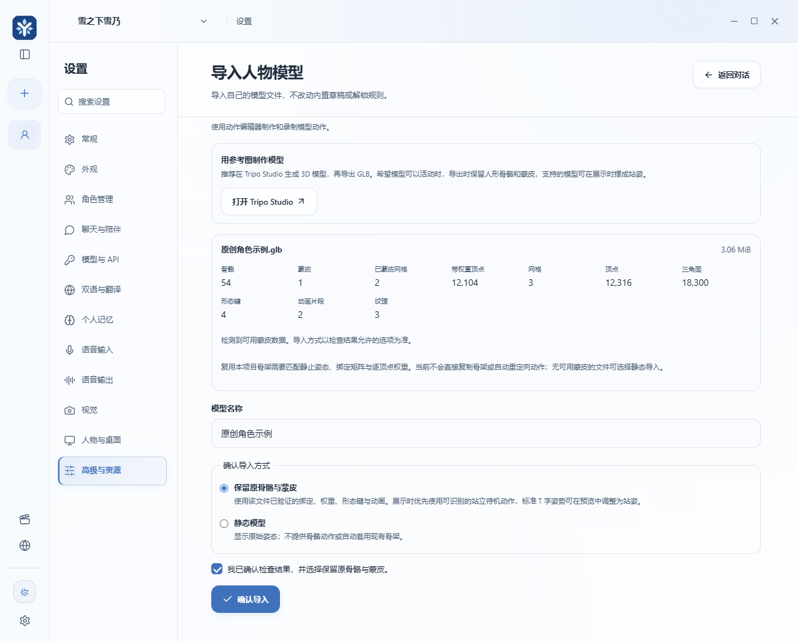
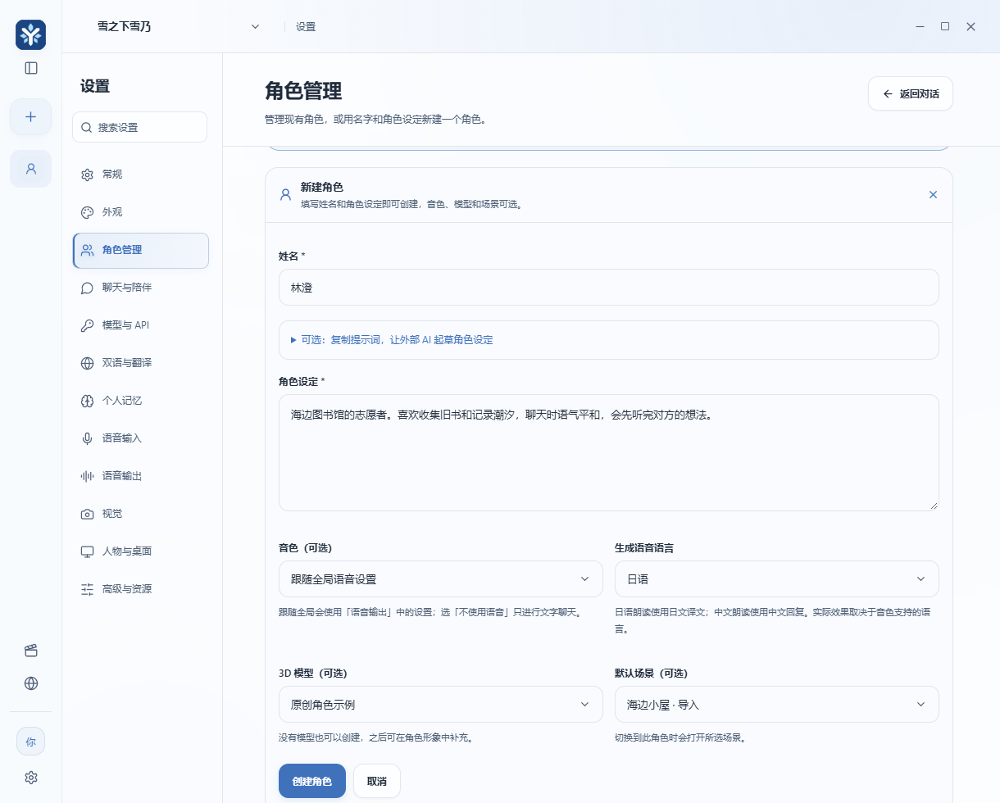
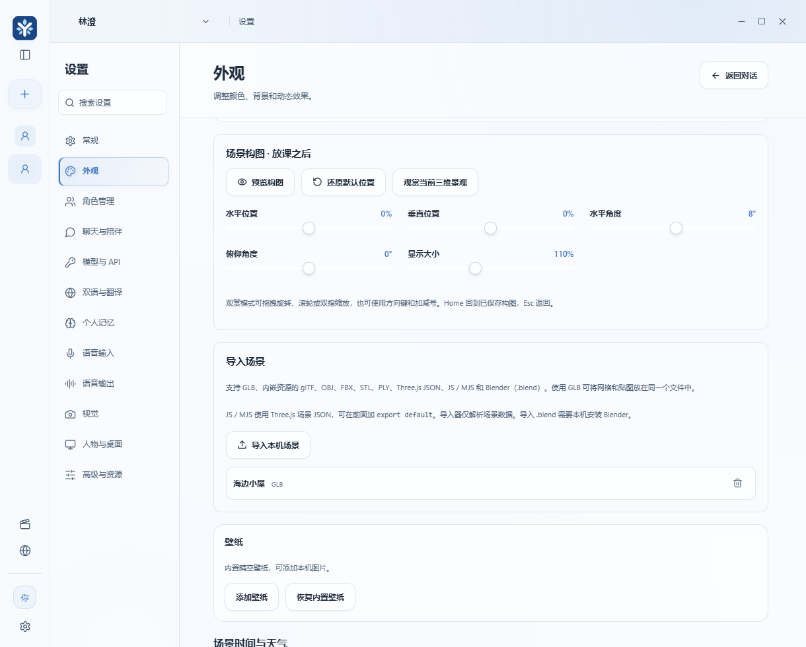

# 自定义角色、3D 人物和场景

在 Yukino Companion 里，角色包含姓名、角色设定，以及可选的音色、3D 形象和默认场景。只想添加一个文字聊天角色时，直接从[创建角色](#create-character)开始。已经有 `.glb` 或 `.vrm` 人物文件时，可以先[导入人物模型](#import-avatar)。本指南以当前源码中的桌面版界面为准，安装器的功能范围请查看对应发行页。 [Yukino Companion Releases](https://github.com/fqxxzyw/Yukino-Companion/releases)

## 选择制作工具

| 手头的素材 | 制作路线 | 交付文件 |
| --- | --- | --- |
| 已有兼容的人物模型 | 在应用里选择文件、检查并确认导入 | GLB 2.0 或 VRM 1.0 |
| 一张原创或已获授权的全身参考图 | 在 Tripo Studio 生成，按需绑定骨骼并在 Blender 修整 | GLB 2.0 |
| 想捏一个动漫风角色 | 在 VRoid Studio 编辑发型、脸、体型和服装 | VRM 1.0 |
| 想从参考图做头身分离、蒙皮和发饰物理 | 用 Charakuru 联合 Tripo、Blender 和有相应工具的智能体逐阶段制作 | VRM 1.0，另留 Blender 工程 |
| 已有 FBX、OBJ 或 Blender 人物工程 | 在 Blender 整理几何、贴图和骨骼后重新导出 | GLB 2.0，或用 VRM 插件导出 VRM 1.0 |

### 用 Tripo Studio 从参考图生成模型

1. 准备你有权使用的清晰全身图，尽量露出手脚、衣装边缘和发型。正面图适合起步，背面或侧面参考能帮助检查模型对不可见部位的推断。
2. 在 Tripo Studio 选择图像生成 3D，上传参考图，选择适合的几何生成模式。生成后旋转查看正面、侧面和背面，确认身体完整、颜色正确、衣服和头发没有明显穿插。 Tripo 是外部服务，上传前在其页面确认账户和额度。 [Tripo Studio](https://studio.tripo3d.ai/) · [图像生成 3D 官方教程](https://www.tripo3d.ai/product-doc/model-generation/image-to-3d)
3. 只做静态形象时可以导出 GLB。需要骨骼动作时，先用人形绑定流程，检查肩、肘、髋、膝等关节的位置和权重。播放一段动作查看关节变形和服装穿插，然后导出。 [Tripo 绑定与动画](https://www.tripo3d.ai/product-doc/module-post-processing/rigging-animation)
4. 在导出面板选 GLB，再到 Yukino Companion 检查。如果 GLB 检查缺少所需的骨骼或动作，而 Tripo 提供带绑定的 FBX，可先将该 FBX 导入 Blender，确认骨骼、蒙皮和动画，再导出单文件 GLB。 [Tripo 导出说明](https://www.tripo3d.ai/product-doc/export-and-integration/export-dcc)

### 用 VRoid Studio 或 Blender 制作

- **VRoid Studio**。新建角色或打开自己的 `.vroid` 工程，编辑脸、发型、体型和服装。点击右上角导出图标，选择「Export VRM」和 **VRM 1.0**，填写模型名、作者和使用许可。若文件过大，回到导出设置降低纹理尺寸，或减少多边形和材质。 [VRoid Studio 下载](https://vroid.com/en/studio) · [VRM 导出说明](https://vroid.pixiv.help/hc/en-us/articles/15760756822297-I-want-to-learn-more-about-the-VRM-export-feature)
- **Blender**。打开现有工程，或导入 FBX / OBJ 等素材。确认人物直立、脚底位置合理，检查材质纹理。需要动作时，给网格绑定 Armature，限制为每顶点最多四个非零权重并归一化。在姿势模式测试关节和裙摆等容易穿插的部位，保留需要的动画与形态键。 [Blender 官网](https://www.blender.org/) · [glTF 2.0 导出手册](https://docs.blender.org/manual/en/latest/addons/scene_gltf2.html)
- **从 Blender 导出 GLB 或 VRM**。在「文件 → 导出 → glTF 2.0」选 `glTF Binary (.glb)`，保留需要的网格、蒙皮、动画、形态键，使用内嵌 PNG/JPEG 贴图并关闭 Draco 压缩。要用 VRM 1.0 时安装 VRM Add-on，检查 Humanoid 的必需骨骼、模型信息和许可，再选择 VRM 1.0 导出。 [VRM Add-on 安装说明](https://vrm-addon-for-blender.info/en-us/installation/) · [VRM 1.0 规范](https://vrm.dev/en/vrm1/index/)

<a id="charakuru"></a>

## 用 Charakuru 制作 VRM

Charakuru 是 Nano 发布的独立制作套件。它把参考图拆分、Tripo 模型候选、Blender 权重与物理设置串在一起。先阅读上游教程和使用条款，再下载 Releases 页面 Assets 里的套件 ZIP，解压到可写文件夹。上游文档提供各阶段界面截图。 [Charakuru 简体中文 README](https://github.com/nanocle/Charakuru/blob/main/README.zh-CN.md) · [图文教程](https://github.com/nanocle/Charakuru/blob/main/docs/tutorial.zh-CN.md) · [下载](https://github.com/nanocle/Charakuru/releases) · [使用条款](https://github.com/nanocle/Charakuru/blob/main/docs/license.md)

1. **准备工具**。上游当前列出 Node.js 22 或更新版本、桌面 Chromium 浏览器、已登录的 Tripo、Blender 5.2、VRM Add-on 和 Blender MCP。用有图像生成与浏览器控制能力的智能体打开解压后的目录，请它先读 `README.zh-CN.md` 和 `AGENTS.md` 并检查依赖。也可在该目录运行 `npm start`，再用浏览器打开 `http://127.0.0.1:8766`。 [Charakuru 上游安装与启动](https://github.com/nanocle/Charakuru/blob/main/README.zh-CN.md)
2. **审图**。在图像库载入获授权的 PNG、JPEG 或 WebP 全身图（上游限制 20 MB），复制页面给出的请求并发给智能体。先审核头部含头发和穿着服装的身体各四个视角，共八张。核对发型、配饰、服装颜色以及左右不对称细节，有问题可退回修订单张。
3. **选候选、调比例**。提交生成候选的请求，旋转比较 Tripo 给出的头部与身体候选，自己选择两者。在模型编辑器按参考图调整头、头发和身体的尺寸及接缝，再确认继续。模型与贴图质量需要从多角度查看。
4. **查动作、导出**。继续提交绑定请求，由具备工具的智能体协助处理骨骼、权重和头发或衣物的摆动。进入动作检查后查看步行时肩膀、手肘和膝盖的变形，也检查头发、裙摆或配饰。确认后点击「导出 VRM」，填写模型名称、作者与使用条款，保存 VRM 文件供 Yukino Companion 检查。需要以后返工时保留整个 Charakuru 工程目录、`project.charakit` 和相关 `.blend`。 [Charakuru 简体中文分步教程](https://github.com/nanocle/Charakuru/blob/main/docs/tutorial.zh-CN.md)

### 把阶段任务交给腾讯 WorkBuddy 或其他智能体

Charakuru 的标准流程以带图像生成和浏览器控制的 Codex 为例。可以让 WorkBuddy 或其他智能体处理其环境支持的任务，例如检查工作目录、整理输入、核对输出或生成验收报告。实际能否操作已登录的 Tripo、把图片放回 Charakuru、调用 Blender MCP，取决于当前客户端和已连接工具，请先逐项试运行。需要人工完成时，把输出放回同一个工程再继续。 [腾讯 WorkBuddy 官网](https://www.workbuddy.cn/) · [腾讯云产品说明](https://cloud.tencent.com/product/workbuddy) · [Charakuru 上游教程](https://github.com/nanocle/Charakuru/blob/main/docs/tutorial.zh-CN.md)

1. 在 WorkBuddy 或其他智能体中创建任务，把解压的 Charakuru 文件夹添加为工作区。先授权它读工作区的 `README.zh-CN.md`、`AGENTS.md` 和本阶段涉及的资料。确认它能读取 `project.charakit`、使用所需工具，并在有权限时保存交付件。
2. 在 Charakuru 点击当前阶段的继续按钮，把复制的请求粘贴到智能体任务中。保留请求里的阶段和工程上下文，只补充你要检查的细节。每次提交一个阶段，完成后回 Charakuru 审图、选择模型、确认比例或预览动作，再提交下一阶段。
3. 若图像生成、浏览器下载或 Blender 操作缺少可用工具，让智能体指出需要手工完成的动作和输出文件。自行完成或交给已具备能力的工具，回来检查结果是否已经登记到同一工程。WorkBuddy 可以协助整理和检查文件，完整制作流程仍以各阶段的实际产物为准。

可复制下面的任务示例，再附上实际的阶段请求。

```text
请读取本工作区的 README.zh-CN.md、AGENTS.md 和下方的 Charakuru 阶段请求。
先检查这个阶段所需的文件、浏览器操作和 Blender 工具是否可用。
只执行本阶段。在审图、选模型、确认比例或检查动作时停下来，等我确认。
如果缺少工具或权限，请告诉我该手工完成的操作、要保存的文件和下一步。
完成后列出工程内生成的相对文件路径、实际检查过的内容和待我确认的事项。

【粘贴 Charakuru 当前阶段复制的请求】
```

浏览器登录和付费确认由你在服务页面完成。外部智能体和云服务仅接收有权分享的参考图和任务材料。公开截图、示例工程或问题报告前，使用演示数据，或裁掉账号、邮箱、真实姓名、头像、聊天、个人路径和订单信息。凭据、令牌和验证码应从公开材料中移除。文中应用截图使用演示资料。

<a id="import-avatar"></a>

## 在 Yukino Companion 中导入人物模型

1. 打开桌面版「设置 → 高级与资源 → 导入人物模型」，点击「选择并检查 GLB / VRM」。选择单文件 GLB 2.0 或 VRM 1.0，最大 **64 MiB**，纹理需内嵌。人物导入对模型结构和扩展有检查，完整限制可查看实现。 [人物模型检查代码](../electron/character-models.cjs)
2. 查看骨骼、已蒙皮网格、带权重顶点、形态键、动画片段和纹理等报告。有可用蒙皮时按界面提示选「保留原骨骼与蒙皮」，只有静态几何时可选「静态模型」。填模型名称，勾选确认并点击「确认导入」。模型会复制到本机模型库，并加入当前角色的衣柜。
3. 在「角色管理」选择已有模型或创建角色时绑定它，返回对话检查预览。如果导出带待机动作，检查站立姿势和脚底位置。口型、眨眼和内置动作需要适配对应角色，模型检查结果里的形态键或动画数量只说明检测到了文件数据。



| 检查或预览现象 | 处理方法 |
| --- | --- |
| 文件过大或提示外部纹理 | 降低贴图尺寸、简化网格或删除未使用素材，再用 GLB Binary / VRM 1.0 导出单文件。 |
| 检出四个以上非零骨骼影响 | 在制作工具中限制每顶点四权重并归一化，重新导出。 |
| 只有静态模式 | 在 Blender 或 Tripo 完成真实骨骼绑定和蒙皮后重新检查。复制其他角色的骨骼无法补齐当前模型的绑定矩阵和顶点权重。 |
| 格式或扩展不支持 | 确认 VRM 版本为 1.0，或改用无 Draco 等压缩扩展的 GLB。根据检查信息调整材质或导出选项。 |

<a id="create-character"></a>

## 创建并切换角色

1. 打开「设置 → 角色管理」，在角色列表下点击「新建角色」展开表单。
2. 填写「姓名」和「角色设定」。设定可以写身份、说话风格、关系边界和几句示例对话。可手写，也可展开「复制提示词，让外部 AI 起草角色设定」，审阅草稿后粘贴回表单。
3. 按需选择「3D 模型」「默认场景」、音色和语音语言。默认场景可选内置场景、已导入场景或「跟随场景设置」。要用自己的场景，请先在外观中导入。
4. 点击「创建角色」，回到对话确认姓名、形象和场景。已有角色可在「当前角色的形象」修改默认场景和模型。切换到设有默认场景的角色时，应用会打开该场景。



<a id="scene-settings"></a>

## 导入和调整三维场景

1. 打开「设置 → 外观」，在三维场景区选择内置场景，或点击「导入本机场景」选择文件。导入后的场景可从该区切换，也可以选为某个角色的默认场景。
2. 点击「预览构图」，用「水平位置」「垂直位置」「水平角度」「俯仰角度」和「显示大小」调整画面。设置按场景保存，换到另一个场景可以独立调整。点击「还原默认位置」可恢复当前场景的初始构图、角度和比例。
3. 返回对话确认效果。「环境延伸到整个界面」可以控制场景显示范围。开启壁纸时可重新选择三维场景以切回场景背景。观赏模式里的拖拽或缩放可用来临时看细节，持久调整请回到外观设置。



| 格式 | 准备方式 |
| --- | --- |
| `.glb`、`.gltf` | 优先使用 GLB。使用 `.gltf` 时把几何缓冲和纹理内嵌在同一文件中。 |
| `.blend` | 桌面版调用本机 Blender 转换为 GLB。先打包外部资源。标准安装目录或 PATH 可供应用查找 Blender，便携版也可设置 `YUKINO_BLENDER_PATH` 指向 Blender 可执行文件后重启应用。找不到 Blender 或转换失败时，可以从 Blender 手动导出 GLB。 |
| `.obj`、`.fbx`、`.stl`、`.ply` | 适合导入模型几何。OBJ 外部 `.mtl` 或外链贴图应先在制作工具中转成单文件 GLB；STL 等网格文件通常只带几何。 |
| `.json`、`.js`、`.mjs` | 使用 Three.js 的 `Scene.toJSON()` 或 `Object3D.toJSON()` 数据。`.js`、`.mjs` 只接收纯 JSON，或 `export default` 后跟同样的 JSON 数据。场景文件按数据解析，不运行其中的 JavaScript。 |

场景文件和 Blender 转换结果各最多 **128 MiB**。自定义场景文件保存在本机。分享场景前请检查是否含有未授权的贴图、素材或个人信息。 [Blender glTF 导出手册](https://docs.blender.org/manual/en/latest/addons/scene_gltf2.html) · [Three.js ObjectLoader](https://threejs.org/docs/#api/en/loaders/ObjectLoader)
