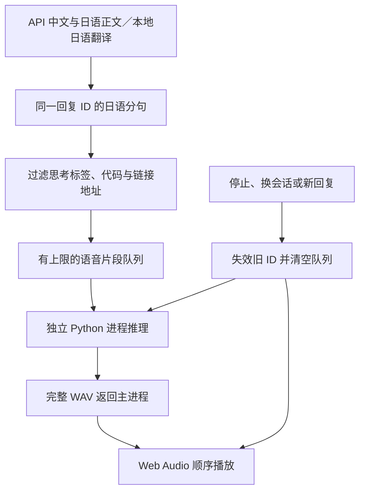

# GPT-SoVITS 本地语音推理

本次实现只接入**已训练模型的推理**，不包含训练、数据标注、WebUI或语音识别。支持下载用户已公开发布的雪乃音色，亦保留本地权重导入。文字回复无论来自远程 API，还是已经运行的本机小模型兼容 API，都进入同一套分句和播放流程。内置本地 LLM 加载仍未实现。

## 已实现与验证边界

- 选择本机 GPT `.ckpt`、SoVITS `.pth`、参考音频、对应文本和公共基础模型；只保存路径，不复制权重。
- 独立 Python 子进程直接调用官方 `TTS_infer_pack.TTS`，不需要用户启动 HTTP API 或 WebUI，也不占用推理端口。
- 检测所选 Python 环境内的 PyTorch、CUDA 与实际张量运算；自动模式在没有可用 CUDA 时选择 CPU。CPU 始终 FP32；GPU FP16 可选。
- 可选择显存不足时回退 CPU；CPU 线程、语速、单次超时、播放音量可调。
- 权重加载/卸载、参考音频检查、试听、自动朗读和单条回复重读。
- 分句、过滤显式思考/动作标签与代码、串行合成及播放、队列上限、停止与迟到结果隔离。
- 语音失败保留文字对话；中止推理只结束本应用启动的那个进程。

**尚未验证用户音色的实际效果。** 已收到并校验 GPT e2 / SoVITS e1 权重结构、资源摘要与实际安全解压；Release 尚未提供参考音频及准确转录，因此没有真实合成试听。不能据此宣称音色还原、所有模型版本兼容、GPU 延迟或 Windows 听感已通过验收。模拟音频仅用于联动测试，不是声音模型完成的证据。人物口型尚未接入；播放状态已可供后续人物适配器使用。

## 官方来源与固定版本

- 上游：[RVC-Boss/GPT-SoVITS](https://github.com/RVC-Boss/GPT-SoVITS)
- 本次核对版本：[b4570b876f5c086819ba84e3215472733c6a7b70](https://github.com/RVC-Boss/GPT-SoVITS/commit/b4570b876f5c086819ba84e3215472733c6a7b70)
- [官方推理引擎](https://github.com/RVC-Boss/GPT-SoVITS/blob/b4570b876f5c086819ba84e3215472733c6a7b70/GPT_SoVITS/TTS_infer_pack/TTS.py)
- [官方 API 参数参考](https://github.com/RVC-Boss/GPT-SoVITS/blob/b4570b876f5c086819ba84e3215472733c6a7b70/api_v2.py)

本项目采用该引擎的 Python 接口，而非复制训练逻辑或运行整个项目。上游接口发生变化时，需要重新验证再更新固定版本。v1/v2/v2Pro/v2ProPlus/v3/v4/v5dev/v5turbo 是该版本声明的模型家族，不代表本项目已逐一获得权重完成实测。

## 完整 EXE 的使用方式

完整 Windows 构建会携带裁剪后的官方推理源码、独立 Python/PyTorch、FFmpeg 和常用语言词典。用户无需安装 Anaconda、打开 WebUI 或手动运行 Python。源码在用户数据目录部署一个可写副本，用于上游词典缓存；用户权重始终按原路径引用。

1. 安装后进入「声音与语音」，推理目录、Python 和 FFmpeg 自动填写。
2. 点击「下载 / 校验公共模型」，按固定版本下载约 802 MiB 的 BERT/HuBERT；支持取消、续传、大小与摘要校验。公共组件按钮仅安装 BERT/HuBERT。
3. 在「已发布音色」选择 GPT e1–e5 + SoVITS e1，下载校验后选用；也可以选择你自己的 GPT `.ckpt`、SoVITS `.pth`。补充 3–10 秒参考音频及准确文本后加载并试听。轮次不代表音质排名，不默认声称 e5 最好。
4. 开启自动朗读：先生成/保存中文与日语两个版本，只将完整日语译文分句合成。切换气泡显示语言不会改变合成语言。

普通推送构建 CPU 通用版；手动 Actions 可选择 `cu124` 构建 CUDA 12.4 运行环境。CPU 版可在有显卡的机器运行，但使用 CPU；要使用 GPU，需要 CUDA 版或在高级路径中选择兼容的本机 CUDA Python。程序按该环境实际可运行能力选择设备。

公共模型安装位置、固定来源、长度和摘要记录在 [voice-models.json](../resources/voice-models.json)。大文件使用 SHA-256；小配置文件使用来源 Git blob SHA-1 校验。用户自己的完整资源可直接选择本地路径，避免重复下载。

## 资源清单（完整 EXE 会自动提供运行环境）

| 资源 | 用途 | 说明 |
| --- | --- | --- |
| Python 可执行文件 | 运行推理 | 选择已经安装推理依赖的环境中的 `python.exe`，不是安装器或 `pythonw.exe` |
| 推理源码目录 | 模型结构与文本处理 | 必须包含 `GPT_SoVITS/TTS_infer_pack/TTS.py`，建议使用固定版本或下述裁剪输出 |
| GPT `.ckpt` | 文字到语义预测 | 选择训练时配套的 GPT 权重；只有 `.pth` 通常不够 |
| SoVITS `.pth` | 语义到声音 | 完整权重与 LoRA 的基础依赖不同，不要按扩展名推断版本 |
| 参考音频 | 提供音色/语气参考 | 当前加载时要求 3–10 秒 WAV/FLAC，并填写实际说出的文本和语言 |
| BERT 目录 | 文本特征 | 通常为 `chinese-roberta-wwm-ext-large` 的完整模型目录 |
| HuBERT 目录 | 参考音频特征 | 通常为 `chinese-hubert-base` 的完整模型目录 |
| FFmpeg | 音频处理 | 可显式选择；否则检查推理目录的 `runtime/ffmpeg.exe` 或 PATH |

基础模型目录不能只有一个权重文件，还需 tokenizer、config 等配套文件。推理阶段禁用 Hugging Face 隐式下载；公共基础模型通过明确的下载按钮安装。完整运行环境预取常用语言词典，语言检测使用依赖内置的 lite 模型，避免对话中下载额外的大型检测模型。

高级模型保留官方相对目录规则：Pro 系列可能需要 `GPT_SoVITS/pretrained_models/sv/`；v3 BigVGAN、v4/v5 声码器，以及 LoRA 对应 SoVITS 底模也要保留在上游规定的 `pretrained_models` 路径。具体缺失项会由加载错误给出。本应用不将不完整权重静默替换为其他音色。

## 两种准备方式

### 方式 A：高级用户复用已有官方推理环境

如果你训练时使用的 GPT-SoVITS 环境已经能正常推理，可以优先复用其中的 Python、基础模型与词典。源码接口应与本项目固定版本一致；更旧整合包缺少 `tools.portable_runtime` 等接口时需升级对应推理源码，而不是只替换一个 Python 文件。

在「设置 → 声音与语音」中分别选择 Python、推理目录、权重和参考音频。不要把你自己的权重上传到本仓库。

### 方式 B：生成只含推理源码的组件

在单独目录准备干净的上游副本（不要在训练工程中强制覆盖文件）：

```powershell
git clone https://github.com/RVC-Boss/GPT-SoVITS.git GPT-SoVITS-source
git -C GPT-SoVITS-source checkout b4570b876f5c086819ba84e3215472733c6a7b70
python inference/prepare_runtime.py --source GPT-SoVITS-source --output D:/YukinoInference
```

从本仓库根目录执行最后一行。输出目录必须不存在，脚本不会覆盖已有资源。它会保留必需的推理模块、词典、第三方许可证及文件哈希清单；排除训练入口、WebUI、数据预处理入口、权重、运行环境、CUDA 二进制与 Git 历史。完成后输出目录可独立使用，无需保留临时克隆的上游副本。

部分模型定义与训练共用 Python 类，因此仍依赖 Lightning 等包；“仅推理”不意味着随意删掉这些被推理导入的类。

独立安装依赖时，先创建虚拟环境并安装**相互匹配的 torch 与 torchaudio**。CPU 环境示例：

```powershell
py -3.12 -m venv D:/YukinoInference/.venv
& D:/YukinoInference/.venv/Scripts/python.exe -m pip install torch==2.5.1 torchaudio==2.5.1 --index-url https://download.pytorch.org/whl/cpu
& D:/YukinoInference/.venv/Scripts/python.exe -m pip install -r inference/requirements.txt
```

GPU 环境使用与驱动匹配的 CUDA 构建，按 [PyTorch 安装指引](https://pytorch.org/get-started/locally/) 选择；不要在 CPU wheel 上仅切换 UI 就期待获得 CUDA。CUDA 是本版支持的 GPU 后端；Windows 上只有 AMD/Intel 集显时默认走 CPU，没有实现 DirectML。

`requirements.txt` 是裁剪后的依赖基线，保留语言处理与推理依赖，未安装 Gradio、ASR 或训练入口。Python 依赖及词典可能需要额外系统组件；该文本是开发依赖基线。完整 EXE 的运行环境由 `scripts/build_windows_runtime.py` 构建并内嵌；自选权重只引用本地路径，已发布雪乃音色与 BERT/HuBERT 在应用内按需下载并校验。源码开发者也可以复用原有推理环境。

## 使用步骤

1. 打开「声音与语音」，完整安装包自动选择内嵌 Python，开发版可自行选择，然后点击「检测 GPU / CPU」。检测的是该 Python 的 PyTorch，不是当前电脑是否装过 CUDA 工具包。
2. 填好资源路径、模型版本、参考音频语言和对应文本。合成语言固定为 `all_ja`，旧配置中的中文/自动语言会迁移为日语；参考音频语言不被改写。
3. 选择自动/CPU/CUDA。自动模式优先可用 CUDA；强制 CUDA 不可用时明确报错。默认关闭 GPU 半精度。
4. 点击「加载 / 重新加载」。成功时显示实际设备、精度、模型家族和 CPU 回退状态。
5. 试听一句短文本，确认音色与语言正确。
6. 勾选「自动朗读新回复」，点击「保存配置」，回到聊天。远程模型与本机兼容 API 的回复都会按句朗读。
7. 不再使用语音时点击「卸载模型」，释放由本软件持有的推理进程和模型资源。

更改模型、语言、参考文本、设备或语速后要重新加载；音量立即生效。自动朗读只对下一轮回复生效，开启时不会补读当前已生成的历史文字。重启应用后保留配置，但需要主动加载模型，不在启动时隐式加载数 GB 权重。

## 文字到语音的数据流



- 不是每个 token 合成一次；日语句末、换行和长句上限触发片段。翻译失败时保留文字，不把中文作为语音降级结果。
- Node 与 Python 边界都固定日语并检查假名，阻止纯中文误入。纯汉字的日语短片段（如「先生。」）应与附近完整日语句子合并；这一保守门槛不是通用语言识别器。
- 英文小数不按小数点拆开；未闭合思考标签和代码块不会提前朗读。自动过滤是针对常见 Markdown/标签，不理解任意自定义动作语法。
- 每段等完整 WAV 合成后播放；本版不采用 GPT-SoVITS 的实验性语义 token 音频流。先保证顺序、取消和兼容性。
- 一次只合成/播放一个片段，避免 CPU 跟不上时堆积大量音频；文本队列超过 64 段或朗读内容超过 16000 字符时停止语音并提示，文字继续显示。
- 停止会立即停止本机播放。若 Python 正在加载或合成，结束该工作进程，以保证迟到音频和计算任务不继续；下一次朗读按原配置重新加载。正在播放时模型可以留在内存中。
- 关闭自动朗读、切换会话、新聊天、删除会话、停止生成或文字生成失败，都清理当前朗读。
- 音频在内存中传递，不默认写出录音文件。单段音频与协议缓冲均有限额。

## 故障处理

| 现象 | 检查/处理 |
| --- | --- |
| `No module named ...` | 确认选择的是安装推理依赖的 Python；不要只安装桌面 EXE 就假定已包含 PyTorch |
| 无可用 CUDA | 检查该环境是否装了 CPU wheel、驱动是否可用；可以选择 CPU |
| CUDA 不支持当前显卡或内核错误 | 改用 CPU 或安装与显卡匹配的 PyTorch；自动检测会实际尝试张量计算 |
| CUDA out of memory | 关闭其他 GPU 模型；本软件可按设置回退 CPU，或手动卸载后选择 CPU |
| 参考音频长度错误 | 使用干净的 3–10 秒 WAV/FLAC；文字必须对应音频实际内容 |
| 底模、声码器、tokenizer 或词典缺失 | BERT/HuBERT 可在应用内下载；其它版本特有的底模或声码器按原模型目录补齐，不替换成其他音色 |
| 模型版本或形状不匹配 | 核对训练版本、GPT/SoVITS 配对及是否为 LoRA；不能仅凭 `.pth` 判断兼容性 |
| CPU 太慢或超时 | 缩短试听文本、调整 CPU 线程和 30–900 秒超时；不承诺 CPU 实时合成 |
| 停止后下一次首句较慢 | 正在计算时停止会结束工作进程，下一次需要重新加载权重 |
| 语音失败但有文字 | 这是预期的隔离行为；修复配置后可用回复旁的朗读按钮重试 |

## 开发与测试

- [主进程推理管理](../electron/speech.cjs)：配置校验、进程生命周期、超时、回复 ID、WAV 校验。
- [Python 推理工作进程](../inference/worker.py)：设备探测、官方 TTS 加载、参考音频、CPU 回退与音频编码。
- [分句与文本过滤](../src/speech/text.mjs)、[队列](../src/speech/session.mjs)、[播放器](../src/speech/player.mjs)、[设置界面](../src/speech/VoiceSettings.jsx)。
- [无需权重的 JS 测试](../tests/speech.test.cjs)与[Python 测试](../tests/worker_test.py)。

```bash
npm test
python -m unittest discover -s tests -p '*_test.py'
npm run build
```

真实资源验收至少覆盖：CPU 一轮试听、CUDA 一轮试听（若有设备）、API 流式回复联动、停止合成/停止播放、切换会话、错误权重、缺依赖、参考音频不匹配、重启与卸载。没有对应硬件或真实权重时，必须保留未验证标记。

## Windows 完整构建

```powershell
npm ci
npm run runtime:cpu
npm run dist:win
```

需要 Windows x64 与 Python 3.12。`runtime:cpu` 固定上游源码提交、裁剪推理模块、创建独立 Python 运行目录、安装 CPU PyTorch、复制 FFmpeg、预取语言词典并检查引擎导入；`dist:win` 将生成组件打入 EXE。CUDA 构建改用 `npm run runtime:cuda`，在干净 build 目录进行。

源码运行、UI 测试与 Python 协议测试不要求构建完整运行环境。CI 会执行完整构建并生成实际的 `requirements-resolved.txt`，用于追踪平台依赖。完整安装包的成功状态以对应 Actions/Release 为准；有源代码不代表安装包已经构建成功。


## 已发布音色资源记录（2026-10-25）

来源固定为 [v0.1.0-framework.1](https://github.com/fqxxzyw/Yukino-Companion/releases/tag/v0.1.0-framework.1)。`resources/voice-models.json` 登记 GPT e1–e5 的 GitHub SHA-256，每个 155,087,158 字节；SoVITS ZIP 共用同一下载，78,568,088 字节。

- ZIP SHA-256：`1b4761af82ac6c383ce90983c91d2a853c4f3c8d4a3a6a3eae197823ed2072c9`。
- 唯一允许解压成员：`SoVITS_weights/雪乃_e1_s3561.pth`，84,932,096 字节。
- 解压后 SHA-256：`c14b9f1127a20817d1206f47c5d0fcb483aadad614fd8502690c4ff63fc66c9c`。
- 仅写入 catalog 指定目标路径；拒绝额外文件、路径穿越、符号链接、加密、分卷、越界、过大解压结果。目标权重通过 SHA-256 后才替换，失败或取消不会把半成品设为可用模型。
- 实际 e2+SoVITS 资源完整校验与解压已通过。e1/e3/e4/e5 已登记发布方摘要，尚未逐一完成音色试听。
- 没有配套参考音频时界面明确提示并禁用加载，不伪造参考文本；参考音频与转录仍由用户选择。
- 本轮遵守暂停打包要求，没有构建或发布新 EXE。
